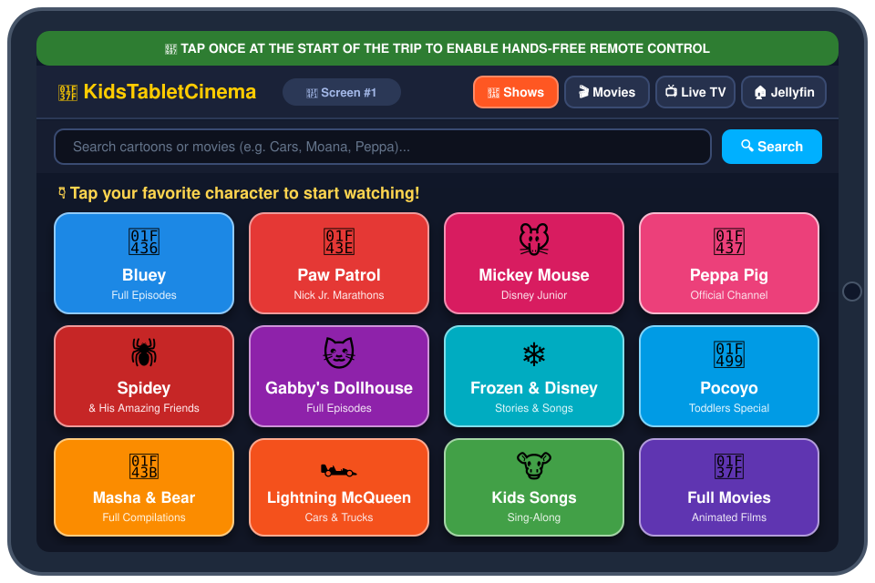
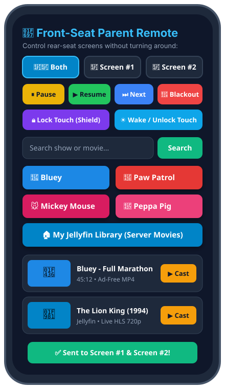

<div align="center">

# 🍿🚗 KidsTabletCinema

**Turn any "dead" 12-year-old iPad (iOS 9+), old Android tablet, or spare phone into a hands-free Car Rear-Seat Cinema for kids — controlled 100% from the front seat.**

*Zero Jailbreak • 100% ES5 Safari Compatible • Ad-Free Streaming • Jellyfin `.mkv` Live Transcoding • Front-Seat Parent Remote Control*

[](https://buymeacoffee.com/sepoti)
[](#-quick-start-with-ai-agent-antigravity--claude-code--codex)
[](#-why-old-ipads-fail--how-kidstabletcinema-fixes-them)
[](#-jellyfin--vlc-offline-mode)
[](LICENSE)

[**🇬🇧 English Documentation**](#-the-problem) • [**🇪🇸 Documentación en Español**](#-documentación-en-español) • [**🤖 1-Click AI Agent Prompt**](#-quick-start-with-ai-agent-antigravity--claude-code--codex) • [**🚗 Car Hardware Setup**](#-recommended-car-hardware-tested-road-trip-setup)

</div>

---

## 📸 Interface Preview

| 👶 Rear-Seat Kids Tablet (`http://server:8090`) | 🚗 Front-Seat Parent Remote (`http://server:8090/padres`) |
| :---: | :---: |
|  |  |

---

## 💡 The Problem

Millions of older tablets—like the **iPad mini 1st Gen (A1455)**, **iPad 2/3/4 (stuck on iOS 9.3.5 / 9.3.6)**, or old Android tablets—still have great screens and healthy batteries, but are effectively **paperweights** today:
1. **Dead Official Apps:** Netflix, Disney+, YouTube, and modern Jellyfin apps refuse to install or connect on iOS 9.
2. **Broken Modern Web (`ES6+` & SSL Certificates):** Modern web interfaces (including Jellyfin Web) use ES6+ JavaScript that crashes Safari on iOS 9 (`WebKit 601.1`) and fail TLS handshakes due to expired root certificates (*ISRG Root X1*).
3. **The "Toddler in the Back Seat" Problem:** Even if you use a newer phone (like an iPhone XS) in the back seat, **a 3-year-old or 5-year-old cannot navigate menus while you drive**—and if they accidentally touch the screen, they pause or exit the movie while you're on the highway.

---

## ✨ How It's Designed to Be Used in the Car (The Road Trip Workflow)

**KidsTabletCinema** runs on your home Mini PC / NAS (via Docker) and serves an ultra-lightweight, **100% pure ES5 web app** over plain HTTP that turns any old or new tablet into a dedicated headrest monitor controlled from the parents' phone in the front seat:

### 1. 🚗 Start of the Trip: 1-Tap Autoplay Unlock + Guided Access
* Mount the iPad/tablet on the headrest, plug it into the car charger, and open the **KidsTabletCinema** web app from the Home Screen icon (full-screen mode via `apple-mobile-web-app-capable`).
* **Tap the green banner once** (*"🚗 Tap here once at the start of the trip"*): this unlocks Apple WebKit's strict media gesture requirement for the rest of the journey so remote commands can start videos with sound automatically.
* *(Optional)* Triple-click the iPad Home button to enable **iOS Guided Access** (with Auto-Lock set to *Never*). Now the physical Home button is disabled. **You won't need to touch the iPad again for the entire trip.**

### 2. 📱📱 Front-Seat Parent DJ (`/padres`)
* From the front passenger seat (or before pulling out), open `http://your-server:8090/padres` on your smartphone.
* Select **`📱📱 Both`**, **`📱 Screen #1`**, or **`📱 Screen #2`** (perfect if you have two kids—e.g., a 3-year-old watching *Pocoyo* on Screen #1 and a 5-year-old watching *Bluey* or *Spidey* on Screen #2).
* Tap **`▶️ Cast`**: within 1.5 seconds, the rear tablet automatically switches to **100% Full-Screen Cinema Mode** and starts playing—**with zero ads** and **automatic continuous playback** (when an episode ends, the next one starts automatically).

### 3. 🔒 Touch-Shield Lock ("Monitor Mode")
* Toddlers love touching screens. Tap **`🔒 Lock Touch`** on your phone's `/padres` remote:
  * All video progress bars and buttons disappear on the kids' tablet (the video expands to 100% edge-to-edge).
  * An **invisible touch-shield layer** covers the entire screen. Even if your 3-year-old slaps or swipes the iPad screen, **nothing pauses, nothing scrubs, and nothing exits**.
* Tap **`☀️ Wake / Unlock Touch`** anytime you want to let your older kid pick their own cartoon from the big emoji grid.

### 4. 🌙 Blackout Screen ("Rest / Snack / Night Mode")
* Why leave the iPad on the whole trip? Because turning an iPad completely off means climbing into the back seat later to turn it back on.
* Instead, when it's time to eat, look out the window, talk, or nap, tap **`🌙 Blackout Screen`** from `/padres`:
  * The video immediately pauses and the iPad screen turns **100% pitch black** (zero glare at night, minimal battery/CPU usage), appearing completely off.
  * **But the browser stays listening in the background.** Thirty minutes later, when you tap **`▶️ Cast`** or **`▶️ Resume`** from your phone in the front seat, **the screen wakes back up with cartoons automatically!**

---

## 🛠️ Technical Magic Under the Hood

* **Pure ES5 & Classic Flexbox:** Zero `const/let`, zero arrow functions, zero `fetch()`—written specifically so 2012 Mobile Safari (`iOS 9.3.6`) never throws a syntax error.
* **HTTP Byte-Range (`206 Partial Content`) Stream Proxy:** Mobile Safari on iOS refuses to play `<video>` MP4 streams unless the server responds to `Range: bytes=0-1` probes with `206 Partial Content`. Our FastAPI + `yt-dlp` + `deno` backend extracts hardware-friendly H.264/AAC MP4 streams (`format 22/18`) and proxies byte ranges and thumbnails over plain HTTP—bypassing all iOS 9 SSL/TLS certificate expirations.
* **🏠 Live Jellyfin `.mkv` to Apple HLS Transcoder:** Mount your existing Jellyfin `/media/peliculas` and `/media/series` folders. Even if your movies are 1080p `.mkv` files with 5.1 `AC3/DTS` audio (which an old iPad cannot decode natively), the container spins up `ffmpeg` on demand to remux/transcode them into **Apple Native HLS (`.m3u8` + `.ts`)** in ~2 seconds.
* **📥 Built-in Anonymous FTP Server (Port 21) for VLC Offline Mode:** Want to download movies to the iPad's internal storage at home before driving through mountain tunnels with zero cell reception? Open **VLC for iOS** on the iPad, connect via `FTP` to your server IP (no password needed), and download your movies with 1 tap.
* **🔒 Family PIN Lock (Persistent 10-Year Memory):** Protected against internet scanners on public IPs with a 4-digit Family PIN (`ACCESS_PIN`). You type the PIN **once** on your iPad and phone; it is saved in `localStorage` + a 10-year cookie so your kids never see a password screen again.

---

## 🚗 Recommended Car Hardware (Tested Road-Trip Setup)

> 💚 **100% Free & Open-Source — How to Support the Project:**  
> This software is completely free, open-source, and has zero ads or paywalls. If you want to help keep the project alive at **zero extra cost to you**, you can grab your car mounts/chargers—or **buy anything else you need on Amazon**—by clicking through the affiliate links below, or [buy me a coffee](https://buymeacoffee.com/sepoti)!

To keep the tablets securely mounted at eye level and powered throughout long trips without draining aging batteries, here is the recommended car kit:

| Accessory | Why You Need It | Link |
| :--- | :--- | :--- |
| **1. Universal Car Headrest Mount (4.7" – 13")** | Clamps solidly onto the front seat metal headrest bars; 360° rotation fits iPad mini, 10" iPads, iPhone XS, or Nintendo Switch. | [🛒 **View on Amazon**](https://www.amazon.es/dp/B0BVLLF99R?tag=mrsepoti-21) |
| **2. Dual-Port Fast Car Charger (54W/69W USB-C + USB-A)** | Powers **both** rear-seat tablets simultaneously at full brightness without battery drain. Flush metallic fit. | [🛒 **View on Amazon**](https://www.amazon.es/dp/B0BVZFVH7Y?tag=mrsepoti-21) |
| **3. Secondary Tablet Mount / Dash & Vent Holder** | Extra mounting option for a second tablet or smartphone controller in the vehicle. | [🛒 **View on Amazon**](https://www.amazon.es/dp/B09QHLHG5T?tag=mrsepoti-21) |

---

## 🤖 Quick Start with AI Agent (Antigravity / Claude Code / Codex)

Don't want to configure Docker, ports, or DDNS manually? **Copy the prompt below and paste it directly into [Google Antigravity](https://antigravity.google), Claude Code, Cursor, or OpenAI Codex** on your home server / Mini PC:

```markdown
Act as an autonomous DevOps & HomeLab engineer and deploy KidsTabletCinema (https://github.com/MrSepoti/KidsTabletCinema) on my machine.

Before running the deployment, ASK ME these 3 quick questions:
1. What device(s) will the kids use in the car? (e.g., a 10-15 year old iPad/tablet stuck on iOS 9/Android 4 where modern VPN apps cannot be installed, OR a newer tablet/phone like iPhone XS / modern iPad / Android that can install apps).
2. How do I want to connect to my home server when driving outside the house?
   - Recommend Option A (Static Public IP or free DuckDNS domain + Port Forwarding on port 8090) so the tablet in the car requires ZERO extra apps or background VPNs.
   - If my kids' device is modern enough (iOS 15+ / Android 8+) and I don't want to open router ports, offer Option B (Tailscale VPN installed on both the server and the tablet).
   - If my kids' tablet is legacy (iOS 9) AND my ISP uses CGNAT (cannot open router ports), offer Option C (a plain-HTTP TCP tunnel like playit.gg or using Tailscale on the parent's phone as a Wi-Fi hotspot proxy).
3. What 4-digit Family PIN (`ACCESS_PIN`) do I want to set, and do I have a local movies/Jellyfin folder I want to mount?

Once I answer:
1. Clone `https://github.com/MrSepoti/KidsTabletCinema.git` into a clean directory.
2. Detect my machine's local LAN IP automatically and create the `.env` file with my chosen `ACCESS_PIN`, `HOST_LAN_IP`, and media paths (plus `DUCKDNS_DOMAIN` and `DUCKDNS_TOKEN` if I chose DuckDNS).
3. Build and start the Docker container (`docker compose up -d --build`) and verify that `http://localhost:8090` responds with HTTP 200 and that `/api/jellyfin` is protected by my PIN (HTTP 401 without PIN, HTTP 200 with PIN).
4. Give me the exact URLs to open on the kids' tablet (`/`) and on my phone's parent remote (`/padres`), plus instructions to add it to the iOS Home Screen and enable Guided Access.
```

---

## 🐳 Manual Docker Compose Installation

```bash
git clone https://github.com/MrSepoti/KidsTabletCinema.git
cd KidsTabletCinema
cp .env.example .env
# Edit .env with your desired ACCESS_PIN (default: 1234) and Jellyfin media paths
docker compose up -d --build
```

Then open:
* **Kids Tablet:** `http://YOUR_SERVER_IP:8090` *(Tap Share $\rightarrow$ "Add to Home Screen" in Safari)*
* **Parent Front-Seat Remote:** `http://YOUR_SERVER_IP:8090/padres`

---

<hr>

# 🇪🇸 Documentación en Español

**KidsTabletCinema** convierte cualquier iPad antiguo (como el **iPad mini 1 A1455 con iOS 9.3.6**, iPad 2/3/4), tablet vieja o móvil que tengas por casa en un **sistema de cine trasero para el coche**, sin anuncios, sin necesidad de hacer Jailbreak y controlado al 100% desde el móvil de los padres en el asiento delantero.

### 🚗 Cómo lo hemos pensado para usar en el coche (Flujo Real con Niños)

1. **Al empezar el viaje (1 solo toque):**
   * Pones el iPad en el soporte del reposacabezas, lo enchufas al cargador del coche y abres el icono **MiniCine** (que al añadirlo a la pantalla de inicio desde Safari se abre a pantalla completa sin barras de navegador).
   * Tocas una vez la **franja verde superior** (*"🚗 Toca aquí una vez al empezar el viaje"*): esto desbloquea el permiso de audio/vídeo automático de Apple para todo el trayecto.
   * *(Opcional)* Haces triple clic en el botón Home del iPad para activar el **Acceso Guiado** de iOS. Así el botón físico redondo queda desactivado y los niños no pueden salir de la pantalla.
2. **Mando de Padres desde el asiento delantero (`/padres`):**
   * Abres `http://tu-ip:8090/padres` en tu móvil, eliges **`📱📱 Los Dos`**, **`📱 Pantalla #1`** o **`📱 Pantalla #2`**, y tocas **`▶️ Poner`** en cualquier dibujo (*Bluey, Patrulla Canina, Mickey, Peppa Pig, Spidey, Gabby, Pocoyó, Frozen...*) o en una película de tu biblioteca **`🏠 Jellyfin`**.
   * El vídeo salta directamente a **Pantalla Completa Automática (Modo Cine)** y cuando acaba un capítulo pasa solo al siguiente.
3. **Botón `🔒 Bloquear Toques` (Modo Monitor Anti-Manotazos):**
   * Desde `/padres` pulsas **`🔒 Bloquear Toques`**: en el iPad desaparecen todos los botones de pausa/barra de tiempo y se activa un **escudo invisible** sobre toda la pantalla. Aunque un niño de 3 años toque o golpee la pantalla, no se pausa ni se sale el vídeo.
4. **Botón `🌙 Pantalla Negra` (Modo Descanso / Noche sin apagar el iPad):**
   * Si quieres que descansen la vista, merendar o hablar con ellos sin tener que desabrocharte el cinturón para apagar el iPad de atrás, pulsas **`🌙 Pantalla Negra`** desde tu móvil: el vídeo se detiene y la pantalla del iPad se queda **totalmente en negro** (como si estuviera apagada), pero sigue escuchando en segundo plano.
   * Cuando media hora después quieras volver a ponerles dibujos, tocas **`▶️ Poner`** o **`☀️ Encender / Desbloquear`** desde tu móvil y **la pantalla del iPad vuelve a encenderse sola con los dibujos**.
   * *(Nota de seguridad para la batería: usa `🌙 Pantalla Negra` durante los viajes; si vas a aparcar el coche al sol o guardar los iPads durante semanas entre viaje y viaje, apágalos del todo con un 60-80% de batería y guárdalos en casa).*

### 🛒 Accesorios de Coche Recomendados (Y cómo apoyar el proyecto gratis)
> 💚 **Proyecto 100% Gratis y de Código Abierto:**  
> Este software es totalmente gratuito y sin anuncios. Si quieres ayudar a mantener vivo el proyecto **sin que te cueste un céntimo extra**, puedes comprar los accesorios para el coche —o **cualquier otra compra que vayas a hacer en Amazon**— entrando desde estos enlaces de afiliado, o [invitarme a un café](https://buymeacoffee.com/sepoti).

* 💺 [**Soporte Universal de Reposacabezas para iPad / Tablet (4.7" a 13")**](https://www.amazon.es/dp/B0BVLLF99R?tag=mrsepoti-21)
* ⚡ [**Cargador de Mechero Doble Carga Rápida (USB-C + USB-A metálico)**](https://www.amazon.es/dp/B0BVZFVH7Y?tag=mrsepoti-21)
* 📱 [**Soporte Secundario Ajustable para Coche**](https://www.amazon.es/dp/B09QHLHG5T?tag=mrsepoti-21)

---

## ☕ Support & Contact / Apoya el Proyecto y Contacto

If **KidsTabletCinema** saved your road trips and gave your old tablets a second life, consider buying me a coffee!

Si este proyecto te ha salvado los viajes en coche y le ha dado una segunda vida a tus viejos iPads, ¡puedes invitarme a un café!

<div align="center">

[](https://buymeacoffee.com/sepoti)

📧 **Contact / Soporte / Colaboraciones:** [sepoti@proton.me](mailto:sepoti@proton.me)  
🐙 **GitHub:** [@MrSepoti](https://github.com/MrSepoti)

</div>
